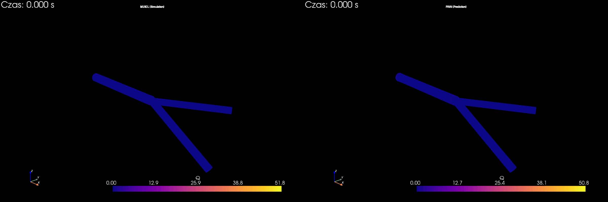

# 1D Blood Flow Simulation & PINN Prediction

This project models 1D blood flow through a Y-shaped bifurcation (a parent vessel splitting into two daughter vessels) using two different approaches:

1. **MUSCL Finite Volume Solver** (`solver.py`): A traditional numerical solver simulating the 1D continuity and momentum equations using the MUSCL-Hancock method.
2. **Physics-Informed Neural Network (PINN)** (`train_pinn.py`): A neural network built with PyTorch and DeepXDE that learns the underlying flow dynamics by strictly enforcing the physical equations, wave reflections, and boundary conditions.

## Visual Comparison

The animation below demonstrates a side-by-side comparison of the flow rate ($Q$) through the arterial branches. The PINN perfectly matches the traditional solver's wave propagation:

