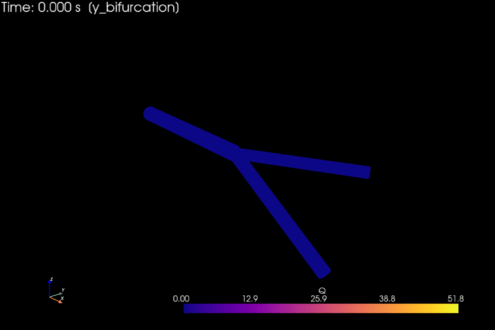
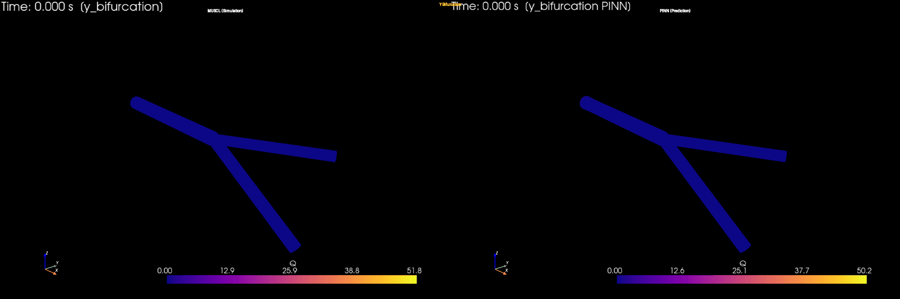
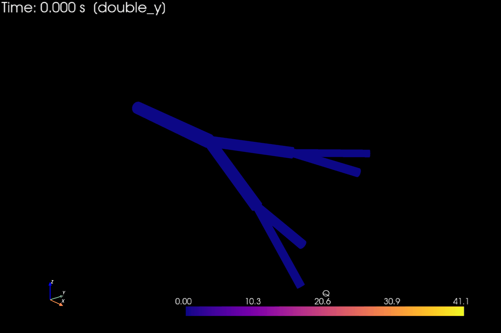

# 1D blood flow — MUSCL solver + PINN surrogate

One-dimensional blood flow in arterial topologies, simulated with a finite-volume MUSCL
solver and emulated with physics-informed neural networks (DeepXDE + PyTorch, one PINN per
topology). Methodology follows Kim & Tithof, "One-Dimensional Modeling of Blood Flow"
(arXiv:2508.18484, PDF in `research_papers/1d_blood_flow_math.pdf`).

Y-bifurcation, MUSCL solver (flow rate Q, vessel radius exaggerated to show deformation):



MUSCL solver (left) vs PINN prediction (right), side by side:



Double-Y topology (parent splits into two daughters, each splitting again):



## Topologies

Defined in `scripts/topology_config.py` (all with c0 = 5 m/s, T_out = 0.75 s, CFL = 0.30):

| topology | structure |
|---|---|
| `straight_tube` | single tube, L = 0.20 m, r = 5.0 mm |
| `y_bifurcation` | parent 0.10 m / 5.0 mm -> daughters 0.08 m / 3.5 mm and 0.09 m / 4.0 mm |
| `split_merge` | parent -> 2 branches -> merge (bifurcation + conjunctions + merge) |
| `double_y` | 1 -> 2 -> 4 vessels (three bifurcations) |

## Quickstart

```bash
git clone https://github.com/DominikJur/1D-blood-flow.git
cd 1D-blood-flow
uv sync                                  # Python 3.13
uv run python scripts/solver.py          # simulate all topologies -> data/*.csv + gifs/*_blood_flow.gif
uv run python scripts/train_pinn.py --train   # train one PINN per topology -> models/*.pth + gifs/*_pinn_prediction.gif
uv run python scripts/aggregate_gifs.py  # side-by-side MUSCL-vs-PINN GIFs -> gifs/*_comparison.gif
uv run python scripts/draw_pignn_diagrams.py  # PIGNN architecture diagrams -> research_papers/*.png
```

`scripts/train_pinn.py --topo y_bifurcation` runs a single topology; without `--train` it
only evaluates a saved model and renders its prediction GIF.

## Layout

- `scripts/topology_config.py` — physical constants, inflow functions, topology definitions
- `scripts/simulation_engine.py` — MUSCL + Rusanov + Adams-Bashforth core, junction solvers
- `scripts/solver.py` — runs all topologies, exports CSV + 3D GIFs
- `scripts/train_pinn.py` — per-topology PINN training / evaluation
- `scripts/aggregate_gifs.py`, `scripts/draw_pignn_diagrams.py` — comparison GIFs, diagrams
- `data/` — solver CSVs (gitignored, regenerate with `scripts/solver.py`)
- `gifs/`, `models/`, `logs/` — committed animations, trained weights, training logs
- `docs/`, `reports/`, `research_papers/`, `presentations/` — notes, alignment report, papers, talks

## Model

State variables: cross-sectional area A(z, t), flow rate Q(z, t). Conservation form:

- continuity: dA/dt + dQ/dz = 0
- momentum: dQ/dt + d(Q^2/A)/dz + (A/rho) dP/dz = -K_R Q/A, K_R = 8 pi mu / rho

Nonlinear tube law P = beta (sqrt(A) - sqrt(A0)), wave speed
c = sqrt(beta / (2 rho)) A^(1/4), Riemann invariants W1,2 = u +/- 4c with u = Q/A.
Junctions enforce mass conservation, total-pressure continuity, and characteristic matching,
solved by a scaled, damped Newton-Raphson iteration.

## Numerical scheme

- MUSCL reconstruction with minmod limiter, Rusanov (local Lax-Friedrichs) interface flux
- Adams-Bashforth 2nd-order time stepping (forward Euler on the first step)
- CFL = 0.30. CFL = 0.45 is unstable with AB2 in this setup (2*dx odd-even oscillations,
  A drops below zero); CFL <= 0.30 runs the full 0.75 s cleanly
- inlet: prescribed Q_in(t) (sine pulses); outlets: non-reflective (W2 = const)

## Outputs

| path | produced by | committed? |
|---|---|---|
| `data/<topo>_blood_flow_data.csv` | `scripts/solver.py` | no (gitignored) |
| `gifs/<topo>_blood_flow.gif` | `scripts/solver.py` | yes |
| `models/<topo>_pinn.pth` | `scripts/train_pinn.py` | yes |
| `gifs/<topo>_pinn_prediction.gif` | `scripts/train_pinn.py` | yes |
| `gifs/<topo>_comparison.gif` | `scripts/aggregate_gifs.py` | yes |
| `logs/train_all.log` | `scripts/train_pinn.py` | yes |

## References

- D. Kim, J. Tithof, arXiv:2508.18484 — `research_papers/1d_blood_flow_math.pdf`
- M. Raissi, P. Perdikaris, G. E. Karniadakis, arXiv:1711.10561 — `research_papers/pinns_original.pdf`
- PIGNN for 1D blood flow — `research_papers/pignn_for_1d_blood_flow.pdf`

(`research_papers/BYOL.pdf` and `self-distillation.pdf` are unrelated reference PDFs.)

Matematyka dla Przemyslu project: Dominik Jur, Szymon Klim, Miroslaw Myszka,
Nikodem Drelak (see `presentations/`).
